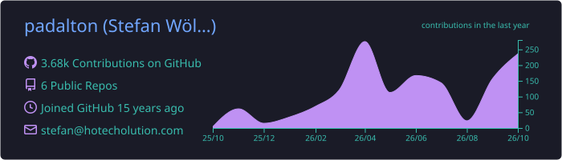
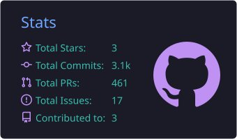
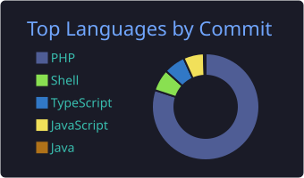

<h1 align="center">Hi, I'm Stefan 👋</h1>
<h3 align="center">Hospitality tech, built from both sides of the front desk · Vienna, Austria</h3>

  <a href="https://hotecholution.com">hotecholution.com</a> ·
  <a href="https://www.linkedin.com/in/stefan-woelflinger">LinkedIn</a> ·
  <a href="mailto:stefan@hotecholution.com">stefan@hotecholution.com</a>

---

### 👨‍💻 About me

- Head of Digital Product & Tech at [raus.life](https://raus.life), design cabins in nature across Germany and Austria.
- Founder of [HoTechOlution](https://hotecholution.com), a one-person studio that builds single-problem SaaS apps for hotels running the [apaleo](https://apaleo.com) PMS. Nights and weekends, since 2023.
- Self-taught developer since 2005. Before that I trained as an automotive technician, which is where the habit of taking things apart before trusting them comes from.
- Five years as CTO of a Vienna hotel company, including its migration from a legacy PMS to apaleo. I know what a tech stack has to survive at 7 a.m. on a Sunday with a full lobby.
- Building on the apaleo API since 2020. Certified data protection expert (Geprüfter Datenschutzexperte, 2018), so privacy by design is part of every product I ship.

**How I build:** deterministic automation first, AI only where it genuinely beats a rule. Full functionality at every pricing tier, tiered by size only. Idea to MVP fast, then finish properly, because the last 20 % is the product.

---

### 🛠️ Tech stack

**Backend & product**

       

**Frontend**

    

**Infrastructure & tooling**

      

**Hardware & home lab**

       

---

### 🏨 What I build

| Product | What it does | Built with |
|---|---|---|
| [**GIMSI**](https://gimsi.app) | Group and proposal management for apaleo hotels: build an offer for a group in minutes, send the PDF, push the reservations straight into the PMS. Live since 2022, certified in the apaleo Store, 27+ hotels, 7,000+ offers, 110,000+ reservations. | Laravel, Livewire, Tailwind, multi-tenant |
| [**GoClearBalance**](https://goclearbalance.app) | Automated dunning for apaleo: finds overdue balances, sends staged notices with payment links, closes the case when the money arrives and keeps an audit trail of every step. | Laravel, Livewire, Horizon, webhooks |
| [**BMD Connector**](https://bmd.hotecholution.com) | Monthly accounting exports from apaleo to BMD and DATEV with a mapping the hotel configures itself. Surfaces payment fees and chargebacks along the way. | Laravel, Livewire |
| [**apaleo LeiwandLock connector**](https://github.com/padalton/apaleo_leiwandlock_connector) | Open-source bridge between apaleo and LeiwandLock, a QR-code room locking system I invented for the hotels I ran tech for. | PHP |

Plus apaleo consulting: onboarding, migrations from legacy systems, custom integrations and a second opinion for in-house teams.

---

### 🚦 Current side project

**[office-traffic-light](https://github.com/padalton/office-traffic-light)**, open source and open hardware. A miniature traffic light for my basement office that tells the family from the hallway whether it is worth coming down: red for meetings, yellow for focused work, green for come in, off when I am not there. The status is detected automatically (microphone or camera in use, calendar, working hours, screen lock) and can be overridden from a KDE Plasma widget, a Stream Deck or the web UI. An E-Ink panel below the lights shows until when and what comes next.

ESP32-C6 firmware in C, a Go hub running in Docker, Home Assistant via MQTT discovery, a KiCad board and an OpenSCAD case. Public from the first commit so you can watch it take shape.

---

### 🧰 Also on my desk

- A home lab with 40+ Docker containers on five mini PCs and thin clients, all self-hosted open source.
- Linux as the daily driver (CachyOS, KDE Plasma on Wayland), with a soft spot for everything that can be automated.
- Build-in-public notes on hospitality tech over on [LinkedIn](https://www.linkedin.com/in/stefan-woelflinger).

---

### 📊 GitHub

  

  
  

  

<picture>
  <source media="(prefers-color-scheme: dark)" srcset="https://raw.githubusercontent.com/padalton/padalton/output/github-snake-dark.svg" />
  <source media="(prefers-color-scheme: light)" srcset="https://raw.githubusercontent.com/padalton/padalton/output/github-snake.svg" />
  
</picture>
